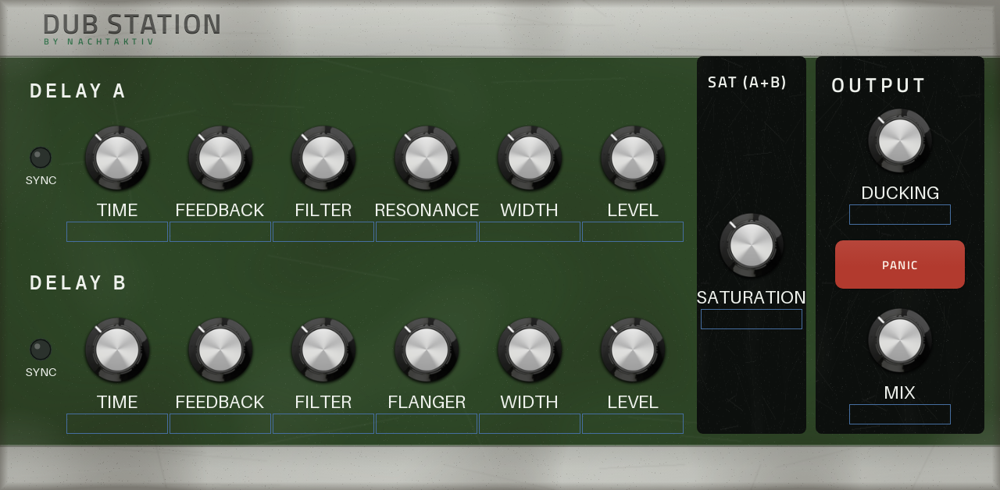
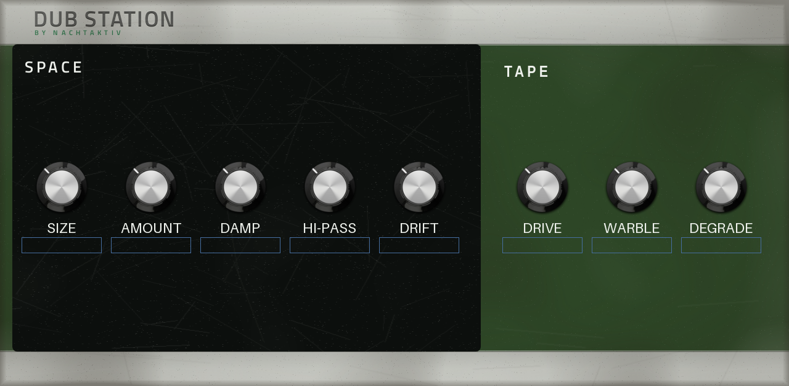
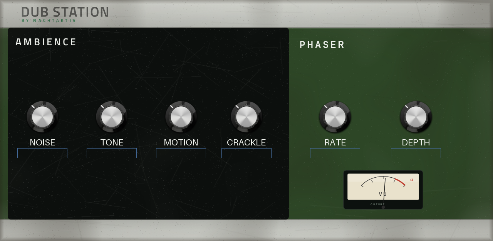

# Dub Station

**Your one-stop effect plugin for dub techno. Not a clone, every bit its own.**

A native VST2 insert effect for standalone Akai MPC / Force devices (MPC OS 3.x), built from scratch
for one job: turning any sound into deep, dubby, cavernous space. Dual tape delay, a huge modulated
reverb, tape grit, an ambience bed and a panic kill, with a Roland Space-Echo–inspired touchscreen skin
and Q-Links.





## Features

- **Dual tape-delay engine** — two fully independent delay lines, each with free or tempo-synced time,
  feedback up to self-oscillation, stereo width (ping-pong + a touch of Haas) and its own level.
- **Two distinct delay voices** — Delay A has a resonant DJ-style filter in its feedback; Delay B a
  bipolar tilt filter plus a built-in flanger, so the two lines never sound the same.
- **Huge modulated reverb** — a lush, cavernous algorithm (Airwindows Galactic) with size, amount,
  damping, hi-pass and drift (vibrato/shimmer), from tight rooms to near-infinite space.
- **Tape & grit** — drive/saturation, warble (wow & flutter) and a vintage-sampler degrade.
- **Ambience bed** — a filtered noise layer (tone + motion) and vinyl crackle breathing under the mix,
  even between hits.
- **Phaser** on the echoes, **ducking** to keep the dry signal clear, a global **mix**, and a **Panic**
  button that instantly flushes every delay/reverb/feedback tail.
- **Space-Echo–inspired interface**, three pages, full Q-Link mapping.

## Install

Download the `*-mpc-armv7.zip` from the [latest release](../../releases/latest), unzip it on the device
and run the installer as root:

```sh
sh install.sh
```

The device must be a modded, rooted MPC/Force (root access is needed to edit `MPC.settings`).
`INSTALL.md` in the zip has the full scripted and manual steps, requirements, CPU figures and checksums.
`uninstall.sh` removes it again.

## Build it yourself

Needs an [`mpc-vst-plugins`](https://github.com/sd88me/mpc-vst-plugins) checkout next to this repo and
Docker:

```sh
MPC_VST=../mpc-vst-plugins vst/build.sh
```

## Credits & licensing

Everything here is MIT-licensed and free to redistribute. The DSP reuses:

- **Airwindows Galactic** reverb — MIT, © Chris Johnson / Airwindows.
- **CHOMPI TAPE 2.0** firmware DSP (delay line, filter, warble) — MIT, © CHOMPI Club / Chase Bliss.
- **DaisySP** utilities — MIT, © Electrosmith.

The dub-techno voicing, the second delay line, the modulation, ambience, panic and the UI are original.
See `src/VENDORED.md` and the per-folder `LICENSE` / `THIRD_PARTY.md` notices for the full attribution.
